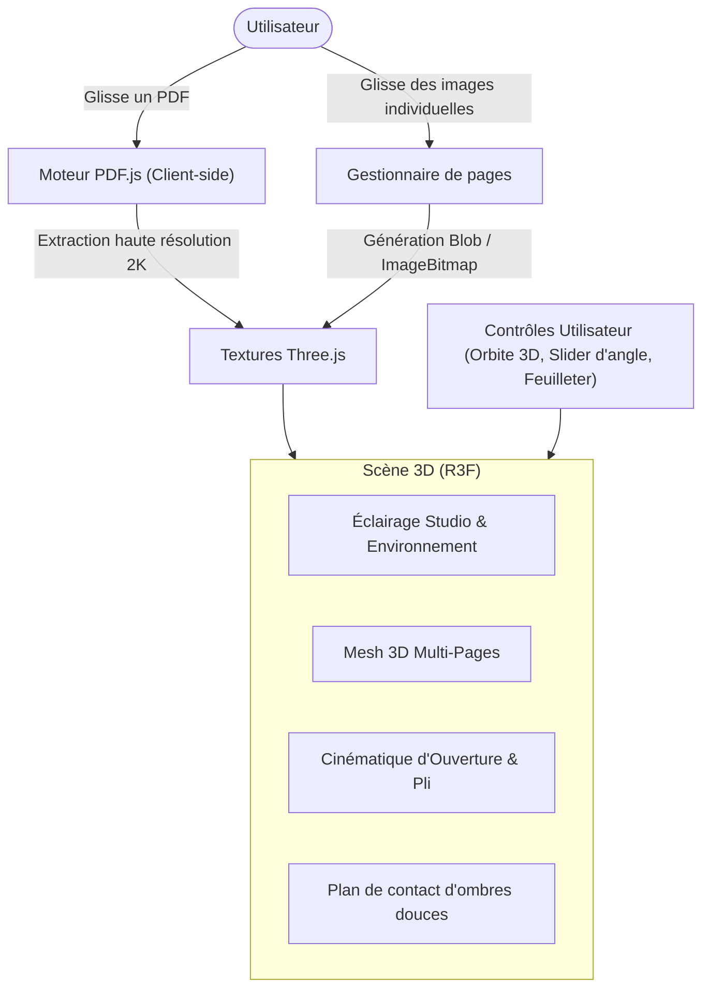

# 📖 Mockz — 3D Print & Book Mockup Studio

> **Studio temps réel de prévisualisation et mockup 3D pour cartes d'invitation, faire-part, livrets, brochures et livres.**
> Visualisez vos créations imprimées en 3D photoréaliste, feuilletez-les page par page et testez vos finitions d'impression.

---

## 🎯 1. Vision du Projet

Dans le monde du graphisme, de l'édition et de l'imprimerie, présenter une maquette réaliste d'un support plié ou relié nécessite souvent des templates Photoshop complexes, lourds et statiques.

**Mockz** résout ce problème en offrant une expérience web temps réel :
1. **Rendu 3D immersif** : Rotation libre à 360°, zoom, éclairage studio dynamique et ombres douces.
2. **Feuilletage réaliste** : Manipulation directe de l'ouverture (du format fermé à plat ou rabattu) et animation naturelle du mouvement de page.
3. **Import universel** :
   - Importation d'un fichier **PDF multi-pages** avec conversion automatique et instantanée des pages en textures 3D.
   - Chargement manuel d'images (PNG, JPG, WebP) face par face.
4. **Base modulaire** :
   - Minimum **4 pages** (règle universelle de l'imprimé plié : Couverture avant, Intérieur gauche, Intérieur droite, Couverture arrière).
   - Ajustable à 8, 12, 16... pages pour les catalogues et brochures.
5. **Laboratoire d'impression (V2)** : Simulation des types de papier (grammage 120g à 350g, couché mat, couché brillant, papier texturé, kraft, dorure à chaud, vernis sélectif).

---

## 📐 2. La Logique des Pages & Formats

### Règle d'or de l'imprimé : La séquence des 4 volets minimum

| Index | Nom du volet | Position physique | Rôle |
|---|---|---|---|
| **Page 1** | Première de couverture (Plat 1) | Extérieur Recto | Titre, visuel principal |
| **Page 2** | Deuxième de couverture (Plat 2) | Intérieur Gauche | Message d'accueil / Début de contenu |
| **Page 3** | Troisième de couverture (Plat 3) | Intérieur Droite | Détails, programme, invitation |
| **Page 4** | Quatrième de couverture (Plat 4) | Extérieur Verso (Dos) | Coordonnées, logo, mentions |

Pour les brochures et livres de $N$ pages, les feuillets s'organisent toujours par paires recto-verso consécutives.

### Formats supportés
- **A5 Portrait (148 × 210 mm)** : Idéal pour faire-part, menus, livrets.
- **A4 Portrait (210 × 297 mm)** : Idéal pour plaquettes d'entreprise, magazines.
- **Carré (150 × 150 mm / 200 × 200 mm)** : Idéal pour invitations de mariage, livres photo.
- **Format Paysage (À l'italienne)** : Idéal pour portfolios et albums.

---

## 🛠️ 3. Architecture Technique

### Stack Technologique
- **Frontend Framework** : React 19 + TypeScript + Vite (vitesse de build et temps réel optimisé).
- **Moteur 3D** : Three.js via `@react-three/fiber` et `@react-three/drei`.
- **Moteur de conversion PDF** : `pdfjs-dist` (traitement 100% exécuté dans le navigateur, zéro coût de serveur, confidentialité totale des designs).
- **UI & Design System** : Tailwind CSS + Lucide Icons (interface moderne type SaaS Pro).
- **Gestion des états** : Zustand ou React State natif pour la réactivité fluide du mockup.

---

## 🧪 4. Simulation Physique & Rendu Papier (Roadmap V2)

Three.js utilise des shaders **PBR** (`MeshPhysicalMaterial`) permettant de reproduire exactement les propriétés optiques et mécaniques des matériaux d'imprimerie :

| Type de papier / Finition | Propriétés Three.js | Effet visuel |
|---|---|---|
| **Papier souple (80g - 120g)** | Courbure souple, légère `transmission` (translucidité) | Onde doucement lors du feuilletage |
| **Papier rigide (250g - 350g)** | `thickness` 0.5-1mm visible sur la tranche, rotation rigide | Reste droit, pli net |
| **Pelliculage Couché Mat** | `roughness: 0.85`, `metalness: 0.05` | Diffusion douce de la lumière, toucher velouté |
| **Pelliculage Couché Brillant** | `roughness: 0.15`, `clearcoat: 0.8` | Réflexion nette des éclairages de studio |
| **Papier Vergé / Kraft / Canson** | `bumpMap` / `normalMap` | Relief de texture de fibre papier visible en rasante |
| **Dorure à chaud (Or / Argent)** | Masque Alpha + `metalness: 1.0`, `roughness: 0.1` | Éclat métallique éclatant selon l'orientation |
| **Vernis Sélectif UV** | Masque Alpha + `clearcoat: 1.0`, `clearcoatRoughness: 0.05` | Brillance localisée sur les titres ou logos |

---

## 🗺️ 5. Feuille de Route de Développement

### Phase 1 : Le Cœur (MVP) — *Complété*
- [x] Spécification et architecture documentée (`PROJECT_OVERVIEW.md`).
- [x] Initialisation de la stack React + Vite + Three.js + Tailwind.
- [x] Conception du composant 3D "Book/Card" multi-pages sans Z-fighting (tranches discrètes).
- [x] Contrôles 3D : Rotation orbitale 360°, zoom, centrage automatique, arrêt/reprise rotation auto.
- [x] Contrôle d'ouverture interactif et cinématique physique (empilement angulaire naturel des feuillets).
- [x] Importateur de PDF automatique via `pdfjs-dist` avec affectation directe des pages en 2K.
- [x] Gestionnaire de pages avec drag-and-drop d'images indépendantes (Recto/Verso par feuille).
- [x] Mode de présentation Client avec lien direct (`?view=client`) et validation BAT.

### Phase 2 : Multi-pages & Ergonomie
- [ ] Support dynamique de 4 à 32 pages avec pagination.
- [ ] Feuilletage interactif au clic ou au geste.
- [ ] Sélecteur de formats prédéfinis (A5, A4, Carré, Paysage).
- [ ] Choix du décor de fond (Studio gris, blanc épuré, table bois, transparent).

### Phase 3 : Simulateur de Papiers & Finitions (V2)
- [ ] Sélecteur de grammage avec incidence sur l'épaisseur et la rigidité.
- [ ] Matériaux prédéfinis : Mat, Brillant, Kraft, Papier à grain.
- [ ] Mode "Dorure & Vernis sélectif" avec import d'un masque de finition.

### Phase 4 : Export & Présentation
- [ ] Export d'images haute définition (PNG transparent, 4K).
- [ ] Générateur d'animation GIF/MP4 pour démonstration client.
- [ ] Mode présentation plein écran.

---

*Projet initialisé par Antigravity pour Medz — Mockz 2026.*

